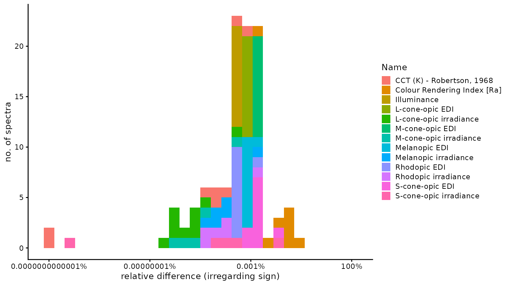
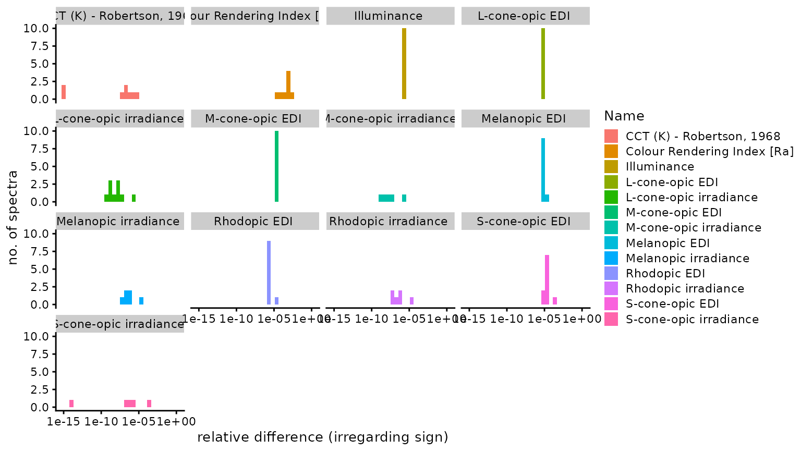
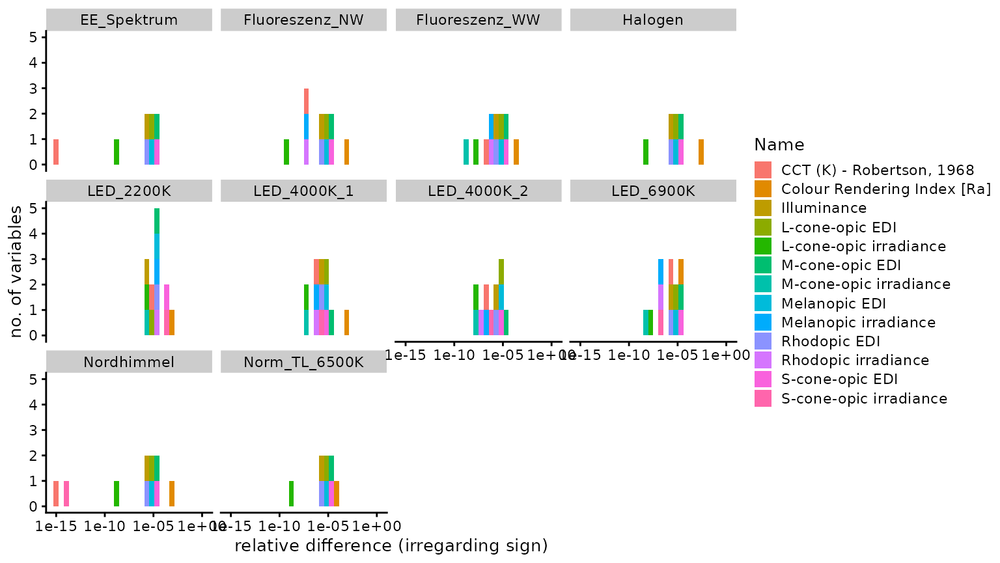
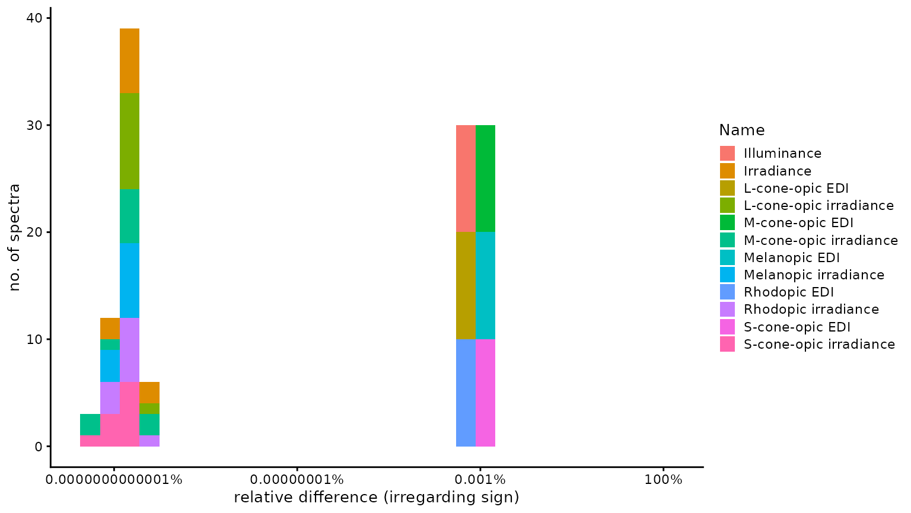
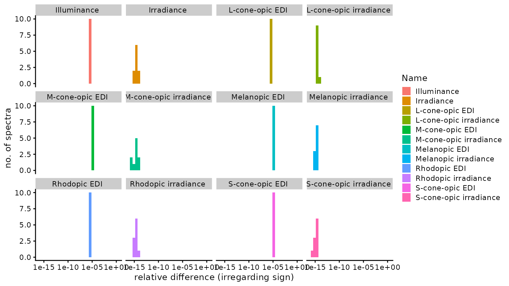
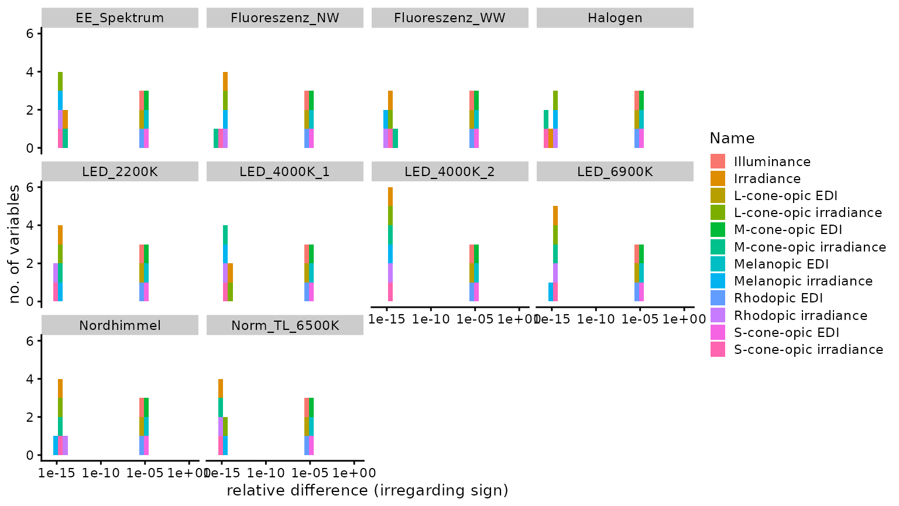

# Validation

## Preface

This document compares the results for ten spectra across the
`Spectral Analysis` Shiny application, the online app
[`luox`](https://luox.app) by Manuel Spitschan, and the free
[`CIE S 026 alpha-opic Toolbox`](https://files.cie.co.at/CIE%20S%20026%20alpha-opic%20Toolbox%20User%20Guide.pdf).
The main goal of this document is to validate the `Spectral Analysis`
application against the methods the CIE has provided or already
validated. We will look at results for `illuminance`,
`α-opic irradiance`, and `α-opic equivalent daylight (D65) illuminance`.
We will also compare the `irradiance` (only with the toolbox) and
`Correlated Color Temperature (CCT)` and `Color-Rendering Index (CRI)`
(only with the luox app), which are only available in one of the two
validated sources. All three sources offer more parameters, but those
are either not part of both the shiny application and a validated source
or are derivatives of the above-mentioned parameters. Some spectral data
files had negative input values (coming straight from the spectrometer
export after measurement). The `Shiny` app replaces these values with
zero, whereas the `CIE toolbox` gives an error for these values. Here,
the values were manually set to zero in the toolbox user input mask. The
`luox` app gives no error for negative values, but it is not exactly
known how the app deals with those values (see below under
@sec-conclusion for more on that).

The results for the `CIE Toolbox` and `luox` were taken on
`21 October 2022` with their respective current version at that date.

## Table Preparation

The following code chunks prepare the tables shown below. The first
chunk loads the necessary libraries:

Setup

``` r


#Setup code, data import, initial data selection to get to one comparison file
#read all libraries
library(dplyr)
#> 
#> Attaching package: 'dplyr'
#> The following objects are masked from 'package:stats':
#> 
#>     filter, lag
#> The following objects are masked from 'package:base':
#> 
#>     intersect, setdiff, setequal, union
library(purrr)
library(ggplot2)
library(tibble)
library(readr)
library(stringr)
library(tidyr)
library(readxl)
library(magick)
#> Linking to ImageMagick 6.9.12.98
#> Enabled features: fontconfig, freetype, fftw, heic, lcms, pango, raw, webp, x11
#> Disabled features: cairo, ghostscript, rsvg
#> Using 4 threads
library(gt)
library(here)
#> here() starts at /home/runner/work/Spectran/Spectran
library(cowplot)
#> 
#> Attaching package: 'cowplot'
#> The following object is masked from 'package:gt':
#> 
#>     as_gtable

#Plottheme
theme_set(theme_cowplot(font_size = 10, font_family = "sans"))
```

The following chunk loads all data:

Data Import

``` r

#Data Import -------------------

##read all filenames and paths of spectra
spectra <- 
  tibble(
    file_names = list.files("./Original_Spectra"),
    file_path = paste0("./Original_Spectra/", list.files("./Original_Spectra"))
    )

##read the csv-files to that spectra
spectra <- 
  spectra %>% 
  rowwise() %>% 
  mutate(Spectrum = list(read_csv(file_path)))
#> Rows: 401 Columns: 2
#> ── Column specification ────────────────────────────────────────────────────────
#> Delimiter: ","
#> dbl (2): Wellenlaenge (nm), Bestrahlungsstaerke
#> 
#> ℹ Use `spec()` to retrieve the full column specification for this data.
#> ℹ Specify the column types or set `show_col_types = FALSE` to quiet this message.
#> Rows: 401 Columns: 2
#> ── Column specification ────────────────────────────────────────────────────────
#> Delimiter: ","
#> dbl (2): Wellenlaenge (nm), Bestrahlungsstaerke (W/m^2)
#> 
#> ℹ Use `spec()` to retrieve the full column specification for this data.
#> ℹ Specify the column types or set `show_col_types = FALSE` to quiet this message.
#> Rows: 401 Columns: 2
#> ── Column specification ────────────────────────────────────────────────────────
#> Delimiter: ","
#> dbl (2): Wellenlaenge (nm), Bestrahlungsstaerke (W/m^2)
#> 
#> ℹ Use `spec()` to retrieve the full column specification for this data.
#> ℹ Specify the column types or set `show_col_types = FALSE` to quiet this message.
#> Rows: 401 Columns: 2
#> ── Column specification ────────────────────────────────────────────────────────
#> Delimiter: ","
#> dbl (2): Wellenlaenge (nm), Bestrahlungsstaerke (W/m^2)
#> 
#> ℹ Use `spec()` to retrieve the full column specification for this data.
#> ℹ Specify the column types or set `show_col_types = FALSE` to quiet this message.
#> Rows: 401 Columns: 2
#> ── Column specification ────────────────────────────────────────────────────────
#> Delimiter: ","
#> dbl (2): Wellenlaenge (nm), Bestrahlungsstaerke (W/m^2)
#> 
#> ℹ Use `spec()` to retrieve the full column specification for this data.
#> ℹ Specify the column types or set `show_col_types = FALSE` to quiet this message.
#> Rows: 401 Columns: 2
#> ── Column specification ────────────────────────────────────────────────────────
#> Delimiter: ","
#> dbl (2): Wellenlaenge (nm), Bestrahlungsstaerke (W/m^2)
#> 
#> ℹ Use `spec()` to retrieve the full column specification for this data.
#> ℹ Specify the column types or set `show_col_types = FALSE` to quiet this message.
#> Rows: 401 Columns: 2
#> ── Column specification ────────────────────────────────────────────────────────
#> Delimiter: ","
#> dbl (2): Wellenlaenge (nm), Bestrahlungsstaerke (W/m^2)
#> 
#> ℹ Use `spec()` to retrieve the full column specification for this data.
#> ℹ Specify the column types or set `show_col_types = FALSE` to quiet this message.
#> Rows: 401 Columns: 2
#> ── Column specification ────────────────────────────────────────────────────────
#> Delimiter: ","
#> dbl (2): Wellenlaenge (nm), Bestrahlungsstaerke (W/m^2)
#> 
#> ℹ Use `spec()` to retrieve the full column specification for this data.
#> ℹ Specify the column types or set `show_col_types = FALSE` to quiet this message.
#> Rows: 401 Columns: 2
#> ── Column specification ────────────────────────────────────────────────────────
#> Delimiter: ","
#> dbl (2): Wellenlaenge (nm), Bestrahlungsstaerke (W/m^2)
#> 
#> ℹ Use `spec()` to retrieve the full column specification for this data.
#> ℹ Specify the column types or set `show_col_types = FALSE` to quiet this message.
#> Rows: 401 Columns: 2
#> ── Column specification ────────────────────────────────────────────────────────
#> Delimiter: ","
#> dbl (2): Wellenlaenge (nm), Bestrahlungsstaerke (W/m^2)
#> 
#> ℹ Use `spec()` to retrieve the full column specification for this data.
#> ℹ Specify the column types or set `show_col_types = FALSE` to quiet this message.

##create a name column 
spectra <- 
  spectra %>% 
  mutate(spectrum_name = str_replace(file_names, ".csv", ""))

##read the results from the luox app
spectra <- 
  spectra %>% 
  rowwise() %>% 
  mutate(
    luox = list(
      read_csv(
        paste0("./Results_Luox_2022-10-21/", spectrum_name, 
               "/download-calc.csv")
        )
      )
    )
#> Rows: 35 Columns: 2
#> ── Column specification ────────────────────────────────────────────────────────
#> Delimiter: ","
#> chr (1): Condition
#> dbl (1): Bestrahlungsstaerke (W/m^2)
#> 
#> ℹ Use `spec()` to retrieve the full column specification for this data.
#> ℹ Specify the column types or set `show_col_types = FALSE` to quiet this message.
#> Rows: 35 Columns: 2
#> ── Column specification ────────────────────────────────────────────────────────
#> Delimiter: ","
#> chr (1): Condition
#> dbl (1): Bestrahlungsstaerke (W/m^2)
#> 
#> ℹ Use `spec()` to retrieve the full column specification for this data.
#> ℹ Specify the column types or set `show_col_types = FALSE` to quiet this message.
#> Rows: 35 Columns: 2
#> ── Column specification ────────────────────────────────────────────────────────
#> Delimiter: ","
#> chr (1): Condition
#> dbl (1): Bestrahlungsstaerke (W/m^2)
#> 
#> ℹ Use `spec()` to retrieve the full column specification for this data.
#> ℹ Specify the column types or set `show_col_types = FALSE` to quiet this message.
#> Rows: 35 Columns: 2
#> ── Column specification ────────────────────────────────────────────────────────
#> Delimiter: ","
#> chr (1): Condition
#> dbl (1): Bestrahlungsstaerke (W/m^2)
#> 
#> ℹ Use `spec()` to retrieve the full column specification for this data.
#> ℹ Specify the column types or set `show_col_types = FALSE` to quiet this message.
#> Rows: 35 Columns: 2
#> ── Column specification ────────────────────────────────────────────────────────
#> Delimiter: ","
#> chr (1): Condition
#> dbl (1): Bestrahlungsstaerke (W/m^2)
#> 
#> ℹ Use `spec()` to retrieve the full column specification for this data.
#> ℹ Specify the column types or set `show_col_types = FALSE` to quiet this message.
#> Rows: 35 Columns: 2
#> ── Column specification ────────────────────────────────────────────────────────
#> Delimiter: ","
#> chr (1): Condition
#> dbl (1): Bestrahlungsstaerke (W/m^2)
#> 
#> ℹ Use `spec()` to retrieve the full column specification for this data.
#> ℹ Specify the column types or set `show_col_types = FALSE` to quiet this message.
#> Rows: 35 Columns: 2
#> ── Column specification ────────────────────────────────────────────────────────
#> Delimiter: ","
#> chr (1): Condition
#> dbl (1): Bestrahlungsstaerke (W/m^2)
#> 
#> ℹ Use `spec()` to retrieve the full column specification for this data.
#> ℹ Specify the column types or set `show_col_types = FALSE` to quiet this message.
#> Rows: 35 Columns: 2
#> ── Column specification ────────────────────────────────────────────────────────
#> Delimiter: ","
#> chr (1): Condition
#> dbl (1): Bestrahlungsstaerke (W/m^2)
#> 
#> ℹ Use `spec()` to retrieve the full column specification for this data.
#> ℹ Specify the column types or set `show_col_types = FALSE` to quiet this message.
#> Rows: 35 Columns: 2
#> ── Column specification ────────────────────────────────────────────────────────
#> Delimiter: ","
#> chr (1): Condition
#> dbl (1): Bestrahlungsstaerke (W/m^2)
#> 
#> ℹ Use `spec()` to retrieve the full column specification for this data.
#> ℹ Specify the column types or set `show_col_types = FALSE` to quiet this message.
#> Rows: 35 Columns: 2
#> ── Column specification ────────────────────────────────────────────────────────
#> Delimiter: ","
#> chr (1): Condition
#> dbl (1): Bestrahlungsstaerke (W/m^2)
#> 
#> ℹ Use `spec()` to retrieve the full column specification for this data.
#> ℹ Specify the column types or set `show_col_types = FALSE` to quiet this message.

##read the results from the shiny app
###filepath
excel_file_path <- function(spectrum_name) {
  paste0(
    "./Results_ShinyApp/",
    {{ spectrum_name }}, 
    "/",
    {{ spectrum_name }}, 
    "_9_2022-10-20.xlsx"
    )
}
###list for each worksheet in the excel-file
spectra <- 
  spectra %>% 
  rowwise() %>% 
  mutate(
    shiny = list(
      list(
        Radiometrie = read_xlsx(
          excel_file_path(spectrum_name), 
          sheet = "Radiometrie"
          ),
        Photometrie = read_xlsx(
          excel_file_path(spectrum_name), 
          sheet = "Photometrie"
          ),
        Alpha = read_xlsx(
          excel_file_path(spectrum_name), 
          sheet = "Alpha-opisch"
          )
        )
      )
    ) 

##read the results from the CIE toolbox
spectra <- 
  spectra %>% 
  rowwise() %>% 
  mutate(
    toolbox = list(
      read_xlsx(
        paste0(
          "./Results_CIE_Toolbox/", 
          spectrum_name, 
          "/CIE S 026 alpha-opic Toolbox.xlsx"
          ), 
        sheet = "Outputs"
        )
      )
    )
#> New names:
#> New names:
#> New names:
#> New names:
#> New names:
#> New names:
#> New names:
#> New names:
#> New names:
#> New names:
#> • `` -> `...2`
#> • `` -> `...3`
#> • `` -> `...4`
#> • `` -> `...5`
```

The following chunk takes the relevant data for comparison out from the
sources and puts them into one table per comparison spectrum:

Initial Data wrangling

``` r


#Initial Data wrangling -------------------
##take the relevant datapoints from the luox results
### the relevant data in the luox results are in column 2, rows 1, 6 to 15, 22, 
### and 24
locations_luox <- c(1, 6:15, 22, 24)
spectra <- 
  spectra %>% 
  rowwise() %>% 
  mutate(
    excerpt = list(
      tibble(
        Name = luox %>% pull(1) %>% .[locations_luox],
        Results_luox = luox %>% pull(2) %>% .[locations_luox]
        )
      )
    )

###Add a row for irradiance, which is missing in the luox output
spectra <- 
  spectra %>% 
  mutate(
    excerpt = list(
      rbind(
        excerpt[1:11,], 
        c("Irradiance (mW ⋅ m⁻²)", NA), 
        excerpt[12:13,]
        )
      ),
    excerpt = list(
      excerpt %>% mutate(Results_luox = as.numeric(Results_luox))
    )
    )

##extract the relevant datapoints from the shiny app
### the relevant data in the shiny app results are in the list 
### - "Photometrie", column 3, row 1, 
### - "Alpha", column 3 to 7, row 1 to 2 (the order has to be adjusted in order 
###to match the luox data frame)
### - "Radiometrie, column 3, row 1, 
### - "Photometrie", column 3, row 4 to 5
shiny_extract <- function(data, sheet, column = Wert, rows) {
  data %>% .[[sheet]] %>% pull({{ column }}) %>% .[rows]
}
spectra <- 
  spectra %>% 
  rowwise() %>% 
  mutate(
    excerpt = list(
      cbind(
        excerpt[1],
        tibble(
        Results_shiny = as.numeric(
          c(
            shiny_extract(
              data = shiny, sheet = "Photometrie", rows = 1),
            shiny_extract(
              data = shiny, sheet = "Alpha", column = "Cyanopsin", rows = 2),
            shiny_extract(
              data = shiny, sheet = "Alpha", column = "Chloropsin", rows = 2),
            shiny_extract(
              data = shiny, sheet = "Alpha", column = "Erythropsin", rows = 2),
            shiny_extract(
              data = shiny, sheet = "Alpha", column = "Rhodopsin", rows = 2),
            shiny_extract(
              data = shiny, sheet = "Alpha", column = "Melanopsin", rows = 2),
            shiny_extract(
              data = shiny, sheet = "Alpha", column = "Cyanopsin", rows = 1),
            shiny_extract(
              data = shiny, sheet = "Alpha", column = "Chloropsin", rows = 1),
            shiny_extract(
              data = shiny, sheet = "Alpha", column = "Erythropsin", rows = 1),
            shiny_extract(
              data = shiny, sheet = "Alpha", column = "Rhodopsin", rows = 1),
            shiny_extract(
              data = shiny, sheet = "Alpha", column = "Melanopsin", rows = 1),
            shiny_extract(
              data = shiny, sheet = "Radiometrie", rows = 1),
            shiny_extract(
              data = shiny, sheet = "Photometrie", rows = c(4, 5))
            )
          )
        ),
        excerpt[2]
        )
      )
  )

##extract the relevant datapoints from the CIE Toolbox
### the relevant data in the toolbox are in 
### column 3, row 14
### column 1 to 5, row 20-> needs to be multiplied by a factor of 1000 to be in 
### mW, to which the other sources are scaled.
### column 1 to 5, row 32
### column 1, row 14 -> needs to be multiplied by a factor of 1000 to be in mW, 
### to which the other sources are scaled.
spectra <- 
  spectra %>% 
  mutate(
    excerpt = list(
      cbind(
        excerpt,
        tibble(
          Results_toolbox = as.numeric(
            c(
              toolbox %>% pull(3) %>% .[14],
              toolbox %>% {as.vector(.[20,])} %>% as.numeric %>% 
                magrittr::multiply_by(1000),
              toolbox %>% {as.vector(.[32,])},
              toolbox %>% pull(1) %>% .[14] %>% as.numeric %>% 
                magrittr::multiply_by(1000),
              NA, NA
              )
            )
          )
        )
      )
    )
```

The following chunk transforms the comparison tables for all spectra
into one comprehensive table.

Putting the table together

``` r

#Putting the table together -------------------
##create a function that calculates the relative difference between the shiny 
##app-results, and another source
Deviation <- function(Results, Results2){
  if(!is.na({{ Results }}) & !is.na({{ Results2 }})){
  res <- 1- {{ Results }} / {{ Results2 }}
  res2 <- vec_fmt_scientific(res)
  if(res < 0) {
    paste0('<div style="color:red">', res2, '</div>')
  }
  else if(res == 0 ) {
    paste0('<div style="color:green">', res2, '</div>')
  }
  else {
    paste0('<div style="color:blue">', res2, '</div>')
  }

  }
  else NA
}

##new dataframe, unnested data, columns for relative difference
Results <- 
  spectra %>% 
  select(spectrum_name, excerpt) %>% 
  unnest(excerpt) %>% 
  rowwise() %>% 
  mutate(Dev_luox = Deviation(Results_luox, Results_shiny),
         Dev_toolbox = Deviation(Results_toolbox, Results_shiny)
         )

##pivoting the dataframe wider, so that each spectrum has only one row
Results <- 
  Results %>% 
  pivot_wider(
    id_cols = spectrum_name, 
    names_from = Name, 
    values_from = c(Results_shiny:Dev_toolbox),
    names_sep = "."
    )

##adding a placeholder for the spectrum picture, with the filepath
###filepath
pdf_file_path <- function(spectrum_name) {
  paste0(""
    )
}
###splicing the dataframes together
Results <- cbind(Results[,1], as_tibble_col(
  pdf_file_path(spectra$spectrum_name), column_name = "Picture"), Results[,-1])
```

The next chunk prepares the table output in a flexible way:

Setting the Table up

``` r

#setting the table up -------------------

##names for the merging
merging_names <- spectra$excerpt[[1]]$Name
merging_names2 <- spectra$excerpt[[1]]$Name %>% str_replace("\\(", "<br>\\(")

##column names for renaming
col_names <- paste0("Results_shiny.", merging_names)
##creating a list with one entry per variable, named after the column name (to 
##be renamed later)
renaming <- rbind(merging_names2)
names(renaming) <- col_names
renaming <- renaming %>% as.list()
renaming <- map(renaming, md)

#creating a list with cells not to format by decimals
number_fmt_col <- 
  Results %>% select(!starts_with("Dev") & !Picture & !spectrum_name) %>% 
  names()

##function that does the merging
merging <- function(data, Name, condition = "difference") {
  if(condition == "difference"){
  data %>% cols_merge(columns = ends_with(Name, ignore.case = FALSE),
             pattern = "<div style='color:lightgrey'>shiny:</div>{1}<div
             style='color:lightgrey'>luox:</div>{4}<div style='color:lightgrey'>
             toolbox:</div>{5}")
  }
  else {
      data %>% cols_merge(columns = ends_with(Name, ignore.case = FALSE),
             pattern = "<div style='color:lightgrey'>shiny:</div>{1}<div
             style='color:lightgrey'>luox:</div>{2}<div style='color:lightgrey'>
             toolbox:</div>{3}")
  }
}

#creating a function for the gt table
comparison_table <- function(tt_text, fn_text, condition) {
gtobj <- Results %>% 
  gt(rowname_col = c("spectrum_name")) %>% 
  tab_header(title = md(paste0("**Validation Results: ",tt_text , "**"))) %>% 
  tab_footnote(footnote = fn_text)

for(i in seq_along(merging_names)) {
  gtobj <- gtobj %>% merging(merging_names[i], condition = condition)
}

gtobj <- gtobj %>%   
  fmt_markdown(columns = everything()) %>%
  fmt_number(
    columns = all_of(number_fmt_col),
    decimals = 3,
    sep_mark = "",
    pattern = "{x}<br>"
    ) %>%
  cols_align(align = "center") %>% 
  cols_label(.list = renaming) %>%
  sub_missing(missing_text = md("---<br>")) %>% 
  cols_width(
    Picture ~px(150),
    everything() ~ px(80)
  ) %>% 
  opt_align_table_header(align = "left") %>% 
  tab_options(table.font.size = "9px")

gtobj

}
```

## Results

This section shows the validation results in two tables. The first table
shows the results for the `Shiny` App per spectrum and parameter
alongside the relative difference of the respective results from the
`luox` app and the `CIE Toolbox`. The second table shows all results per
spectrum and parameter. Note that the `Shiny` App does not provide a
`CRI [Ra]` for the artificial `EE_Spektrum` and the `LED_4000K_2`,
because they exceed the CIE limits for calculation.

- Relative Differences
- Results for all sources

Creating the gt Table

``` r

#creating the gtable -------------------

#text for the subtitle
fn_text <- 
  md(paste0(
    "The first number in every cell shows the Result from the *Shiny* app, ",
    "<br>the second number the **relative** difference of the respective ",
    "result from the *luox* app, <br>whereas the third number shows the same ",
    "for the result from the *CIE S026 Toolbox*. <br><a style='color:green'>",
    "green</a> values indicate a zero difference, <a style='color:red'>red</a>",
    " a negative difference, and <a style='color:blue'>blue</a> a positive ",
    "difference. <br>All *Shiny* values are rounded to three decimals. <br>", 
    "Missing values or pairwise comparisons are indicated by a ---."))

tt_text <- "Relative Differences"
```

``` r

comparison_table(tt_text, fn_text, condition = "difference")
```

[TABLE]

Creating the gt Table

``` r


#creating the gtable -------------------

#text for the subtitle
fn_text <- md("The first number in every cell shows the Result from the *Shiny* 
              app, <br>the second number the result from the *luox* app, <br>
              whereas the third number shows the result from the *CIE S026 
              Toolbox*. <br>All values are rounded to three decimals. <br>
              Missing values are indicated by a ---.")

tt_text <- "All Results"
```

``` r

comparison_table(tt_text, fn_text, condition = "")
```

[TABLE]

A quick overview of the previous table show that the `Shiny` app
produces results that are either identical, or at least very similar to
the `luox` app or the `CIE Toolbox`. The next two sections will provide
a more concise overview of how those sources compare.

Preparing Data

``` r

#extract the relative difference differentiated by spectrum and variable
Discussion <- 
  spectra %>% 
  select(spectrum_name, excerpt) %>% 
  unnest(excerpt) %>% 
  rowwise() %>% 
  mutate(Dev_luox = 1 - Results_luox/Results_shiny,
         Dev_toolbox = 1 - Results_toolbox/Results_shiny
         ) %>% 
  ungroup()

#throwing the units out for visualization
Discussion <- 
  Discussion %>% mutate(Name = str_replace(Name, "\\(mW ⋅ m⁻²\\)", ""),
                        Name = str_replace(Name, "\\(lx\\)", ""))
```

### Pairwise comparison to the `luox` app

luox data

``` r

#creating a subframe for the luox-data, filtered by removing all non-comparisons
Data <- Discussion %>% dplyr::filter(!is.na(Dev_luox))
#number of comparisons made
n <- Data %>% count() %>% pull(1)
#number of comparisons split by difference
n2 <- Data %>% group_by(Dev_luox == 0, Dev_luox > 0, Dev_luox < 0) %>% 
  count() %>% pull(n)
n2[3] <- ifelse(is.na(n2[3]), "none",  n2[3])
#median difference when disregarding sign
n3 <- Data %>% filter(Dev_luox != 0) %>% 
  dplyr::summarise(median = median(abs(Dev_luox))) %>% pull(1)
#maximum difference
n4 <- Data %>% pull(Dev_luox) %>% abs() %>% max()
#where did this difference occur
n4_2 <- Data$Name[abs(Data$Dev_luox) == n4]
```

Of 128 comparisons, 20 were *identical*, 25 were *smaller*, and 83 were
*larger*, using the `luox` results as a basis. The *median* relative
difference was 2.93 × 10⁻⁶ (disregarding sign), i.e., 0.00029%. The
*highest* relative difference (again disregarding sign) was 2.16 × 10⁻³
or 0.22%, which occured for `Colour Rendering Index [Ra]`. The following
figure provides a histogram of all relative differences (excluding zero
difference), colored by variable.

- Overview
- Split by Variable
- Split by Spectrum

histogram

``` r

#make a histogram of the values and calculate relevant values

breaks <- c(10^-15, 10^-10, 10^-5, 1)

Base_Plot <- 
  Data %>% filter(Dev_luox !=0) %>% 
  ggplot(aes(x=abs(Dev_luox))) +
  geom_histogram(aes(fill = Name))+
  xlab("relative difference (irregarding sign)")+
  expand_limits(x= 1)
```

``` r

Base_Plot +
  scale_x_log10(breaks = breaks, labels = c(vec_fmt_number(breaks*100, 
                                                           n_sigfig = 1, 
                                                           pattern = "{x}%"))) +
  ylab("no. of spectra")
```



``` r

Base_Plot +
  scale_x_log10(breaks = breaks)+
  ylab("no. of spectra")+
  facet_wrap("Name")
```



``` r


Base_Plot +
  scale_x_log10(breaks = breaks)+
  ylab("no. of variables")+
  facet_wrap("spectrum_name")
```



### Pairwise comparison to the `CIE Toolbox`

CIE prep

``` r

#creating a subframe for the luox-data, filtered by removing all non-comparisons
Data <- Discussion %>% dplyr::filter(!is.na(Dev_toolbox))
#number of comparisons made
n <- Data %>% count() %>% pull(1)
#number of comparisons split by difference
n2 <- Data %>% group_by(Dev_toolbox == 0, Dev_toolbox > 0, Dev_toolbox < 0) %>% 
  count() %>% pull(n)
n2[3] <- ifelse(is.na(n2[3]), "none",  n2[3])
#median difference when disregarding sign
n3 <- Data %>% filter(Dev_toolbox != 0) %>% 
  dplyr::summarise(median = median(abs(Dev_toolbox))) %>% pull(1)
#maximum difference
n4 <- Data %>% pull(Dev_toolbox) %>% abs() %>% max()
#where did this difference occur
n4_2 <- Data$Name[abs(Data$Dev_toolbox) == n4]
```

Of 120 comparisons, none were *identical*, 25 were *smaller*, and 95
were *larger*, using the `CIE Toolbox` results as a basis. The *median*
relative difference was 1.13 × 10⁻⁶ (disregarding sign), i.e., 0.00011%.
The *highest* relative difference (again disregarding sign) was
1.81 × 10⁻⁵ or 0.0018%, which occured for `M-cone-opic EDI`. The
following figure provides a histogram of all relative differences
(excluding zero difference), colored by variable.

- Overview
- Split by Variable
- Split by Spectrum

Histogram

``` r

#make a histogram of the values and calculate relevant values

Base_Plot <- 
  Data %>% filter(Dev_toolbox !=0) %>% 
  ggplot(aes(x=abs(Dev_toolbox))) +
  geom_histogram(aes(fill = Name))+
  xlab("relative difference (irregarding sign)")+
  expand_limits(x= 1)
```

``` r

Base_Plot +
  scale_x_log10(breaks = breaks, labels = c(vec_fmt_number(breaks*100, 
                                                           n_sigfig = 1, 
                                                           pattern = "{x}%")))+
  ylab("no. of spectra")
```



``` r


Base_Plot +
  scale_x_log10(breaks = breaks)+
  ylab("no. of spectra")+
    facet_wrap("Name")
```



``` r


Base_Plot +
  scale_x_log10(breaks = breaks)+
  ylab("no. of variables")+
  facet_wrap("spectrum_name")
```



## Conclusion

Overall, the agreement between the different sources is very high and
differences only occur several decimals back. For most if not all of
those cases, rounding errors seem a plausible explanation. In an older
version of the `Shiny` app, negative input values for irradiance were
taken at *face value*, i.e., they actually reduced variable values that
require summation. With that state, many more comparisons showed a zero
difference for the `luox` app, which seems to indicate that the *luox
app* also takes negative values at *face value*. However, the median
relative difference in that older state was about double that compared
to the current state for both the `luox` app and the `CIE Toolbox`
sources. Since both the overall error is reduced by the current state of
the `Shiny` app and it is sensible to restrict input values to zero or
positive numbers, this method will be used in the public release.

In summary, the `Shiny` app offers a sufficiently accurate calculation
of ⍺-opic values, especially given its focus on education. It is of
note, however, that the age corrected values could no be validated
against the other two sources, since they don´t provide similar
functionality.
