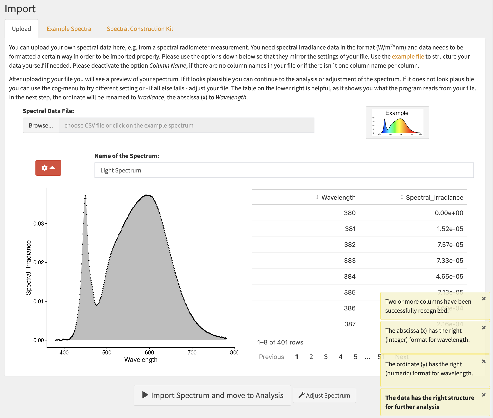

# Spectran

`Spectran`, developed by the German Society for Lighting Technology and
Lighting Design (LiTG), is a Shiny App designed to analyze light spectra
for both visual and non-visual (also known as melanopic) needs. The app
supports the import of spectral data in CSV or text formats and also
offers an extensive library of example spectra. Users can even create
their own spectral distributions within the app. The primary aim of
Spectran is to offer easy access to and a visual representation of the
calculations that underlie commonly used parameters. As such, it serves
as an ideal tool for educational purposes and for generating
presentation-ready graphs in lighting research and application.

The current development version is a prototype that includes
transmission and reflection calculations. The calculation results have
been verified and can already be considered reliable within the scope
described in the [material validation
documentation](https://litgde.github.io/Spectran/articles/Material_Validation.html).
Details of the user guidance and presentation may still change before
the transmission and reflection workflow is released.

Try the development prototype in
[German](https://litg-spectran-prototype.share.connect.posit.cloud/) or
[English](https://litg-spectran-prototype-en.share.connect.posit.cloud/).
Both versions are updated automatically from the `transmission` branch.

## Installation

You can install the stable release version of Spectran from
[CRAN](https://CRAN.R-project.org/package=Spectran) with:

``` r

install.packages("Spectran")
```

You can install the latest development version of Spectran from
[GitHub](https://github.com/) with:

``` r

# install.packages("devtools")
devtools::install_github("LiTGde/Spectran")
```

## How to use Spectran

The commands show how to start Spectran:

[`library(Spectran)`](https://github.com/LiTGde/Spectran)

[`Spectran()`](https://litgde.github.io/Spectran/reference/Spectran.md)

or open the English version hosted on [Posit Connect
Cloud](https://litg-spectran-en.share.connect.posit.cloud/).

You can also use the German version:

`Spectran(lang_setting = "Deutsch")`

or open the German version hosted on [Posit Connect
Cloud](https://litg-spectran-de.share.connect.posit.cloud/).

## Example Screenshots


User Interface (UI) for Melanopic Analysis


UI for Analysis of Age-dependent changes


Export Table for Alpha-opic Quantities


Export File for Photometric Quantities



UI for File Import


UI for Example Spectra Import
